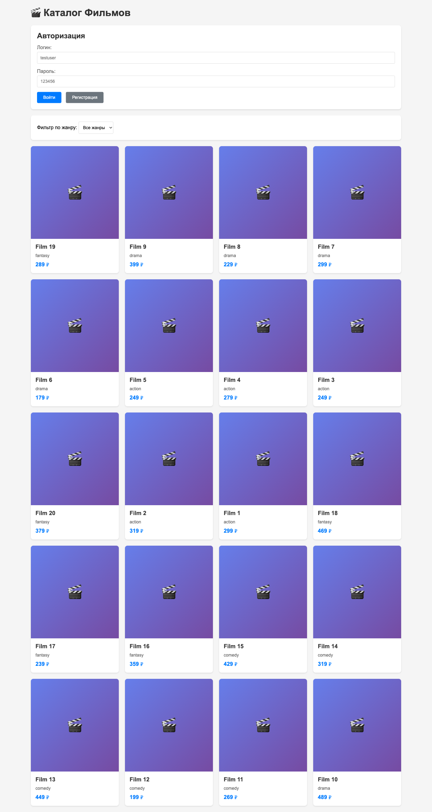
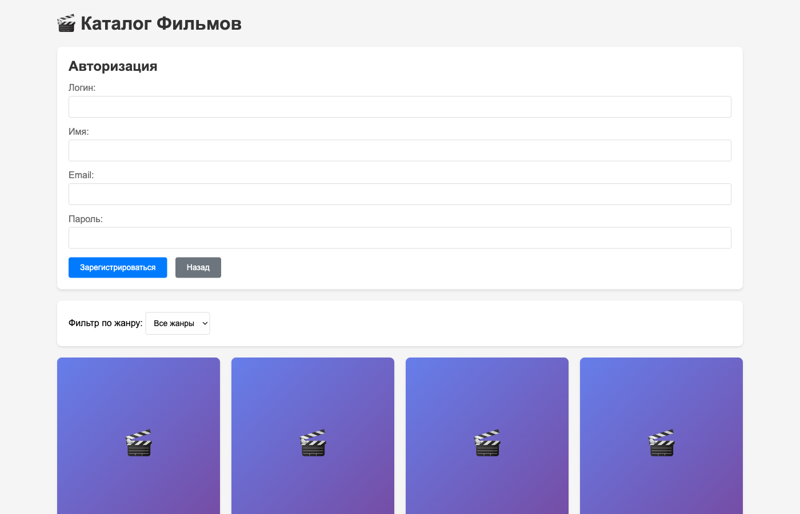
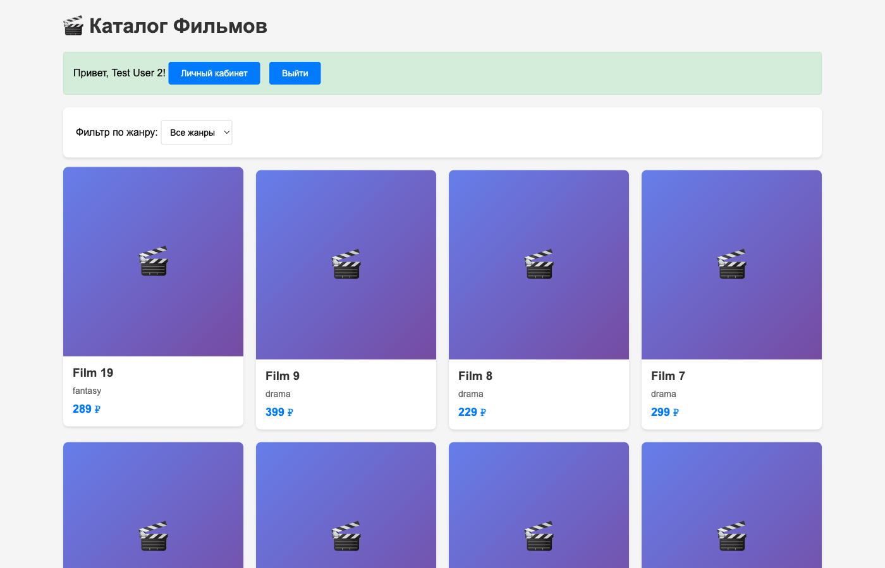
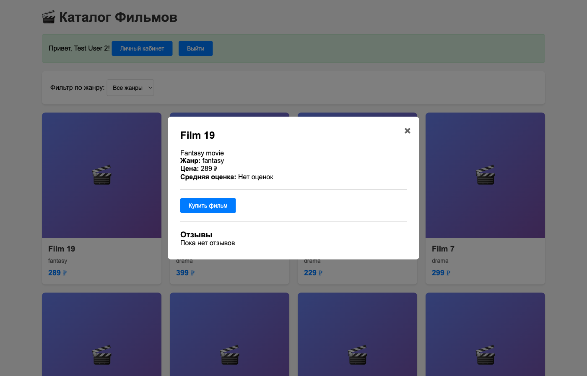
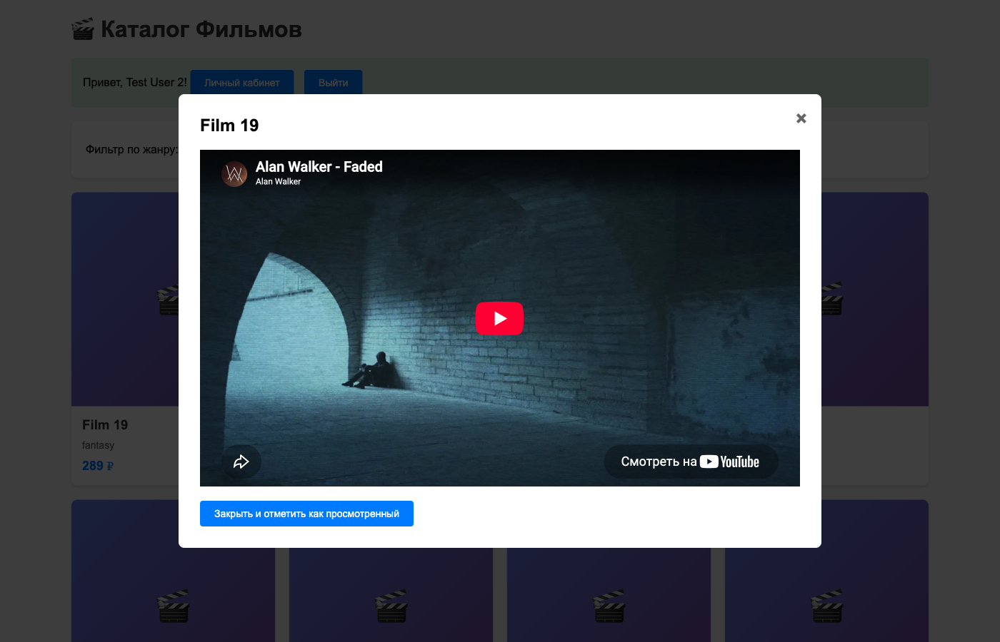
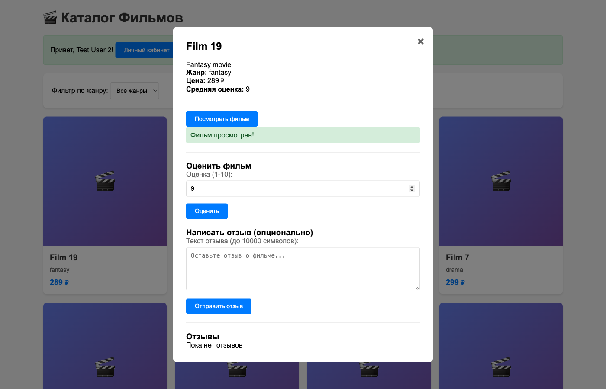

# Микросервисы: Каталог Фильмов

Архитектура из 3 микросервисов с общей базой данных, API Gateway и видеоплеером.

## Архитектура

```
Клиент (Frontend + Video Player)
  ↓
API Gateway (Nginx, порт 8080) - Балансировщик нагрузки
  ↓
├─→ Сервис Каталога (порт 3001) - catalog-service
├─→ Сервис Оценок и Отзывов (порт 3002) - ratings-service
└─→ Сервис Личного Кабинета (порт 3003) - user-service
  ↓
Общая MySQL БД (порт 3307 хоста)
```

## Скриншоты








## Ключевые особенности

### ✅ Отказоустойчивость
- Каждый микросервис работает независимо
- При отключении одного сервиса остальные продолжают работать
- Таймауты (2 сек) для быстрого определения недоступности
- Graceful degradation - показываются сообщения о недоступности вместо падения

### ✅ Общая база данных
- Все три микросервиса используют одну MySQL БД `microservices_db`
- Таблицы распределены по сервисам логически, но физически в одной БД
- Креды доступа: `app_user` / `app_password`

### ✅ Полноценный личный кабинет
- Информация о пользователе (логин, имя, email, дата регистрации)
- История покупок (фильм, цена, дата)
- История просмотров (фильм, дата)
- Мои оценки (фильм, оценка, дата)
- Мои отзывы (фильм, текст, дата)

### ✅ Система отзывов и оценок
- Оценка и отзыв разделены
- Можно оставить только оценку без текста отзыва
- Один пользователь может оставить множество отзывов и оценок
- Средняя оценка считается по всем оценкам (AVG aggregation)
- Отображение оценки рядом с каждым отзывом

### ✅ Видеоплеер
- YouTube плеер встроен в модальное окно
- Каждый фильм имеет свой `video_url` (YouTube embed)
- Кнопка "Закрыть и отметить как просмотренный"
- После просмотра открывается возможность оставить оценку и отзыв

### ✅ Docker контейнеры
- Все сервисы упакованы в Docker контейнеры
- Одной командой запускается всё приложение
- Volumes для сохранения данных БД
- Пересборка при изменении кода

## Сервисы

### 1. Сервис Каталога Фильмов (порт 3001)
- GET `/api/films` - список всех фильмов
- GET `/api/films?genre=action` - фильтр по жанру
- GET `/api/films?search=matrix` - поиск по названию
- GET `/api/films/:id` - детали фильма (включая video_url)
- POST `/api/films` - добавить фильм (admin)
- PUT `/api/films/:id` - обновить фильм (admin)
- DELETE `/api/films/:id` - удалить фильм (admin)

### 2. Сервис Оценок и Отзывов (порт 3002)
- POST `/api/ratings` - поставить оценку (1-10)
- GET `/api/films/:id/ratings` - оценки фильма
- POST `/api/reviews` - написать отзыв (опциональный текст)
- GET `/api/films/:id/reviews` - отзывы фильма с оценками авторов
- PUT `/api/reviews/:id` - редактировать отзыв
- DELETE `/api/reviews/:id` - удалить отзыв

### 3. Сервис Личного Кабинета (порт 3003)
- POST `/api/auth/register` - регистрация
- POST `/api/auth/login` - вход (возвращает JWT токен)
- POST `/api/auth/logout` - выход
- GET `/api/user/profile` - профиль (требуется JWT)
- GET `/api/user/history` - история покупок/просмотров (требуется JWT)
- GET `/api/user/ratings` - мои оценки (требуется JWT)
- GET `/api/user/reviews` - мои отзывы (требуется JWT)
- GET `/api/user/full-profile` - полный профиль со всей историей (требуется JWT)
- POST `/api/user/history/purchase` - добавить покупку (требуется JWT)
- POST `/api/user/history/view` - добавить просмотр (требуется JWT)

## Запуск

1. Установить Docker и Docker Compose
2. Запустить проект:
```bash
cd "/Users/aleksandrsmirnov/Desktop/микросервис практика"
docker-compose up -d --build
```

3. Сервисы будут доступны:
- API Gateway (Frontend): http://localhost:8080
- Сервис каталога напрямую: http://localhost:3001
- Сервис оценок напрямую: http://localhost:3002
- Сервис кабинета напрямую: http://localhost:3003
- MySQL: localhost:3307

## Демонстрация отказоустойчивости

```bash
# Остановить catalog-service
docker stop catalog_service
# Обновить страницу - увидите "Сервис каталога недоступен"
# Фильмы не загрузятся, но авторизация и оценки будут работать

# Остановить ratings-service
docker stop ratings_service
# Откройте фильм - увидите "Сервис оценок недоступен"
# Фильмы открываются, но без оценок и отзывов

# Остановить user-service
docker stop user_service
# Невозможно войти в систему
# Но фильмы и отзывы доступны

# Запустить все обратно
docker-compose up -d
```

## Структура БД

- `users` - пользователи (login, username, email, password_hash)
- `user_purchases` - покупки пользователей (user_id, film_id, film_title, price)
- `user_views` - просмотры пользователей (user_id, film_id, film_title)
- `films` - каталог фильмов (id, title, description, price, genre, img_url, video_url)
- `ratings` - оценки фильмов (user_id, film_id, score) - поддерживает множество оценок от одного пользователя
- `reviews` - отзывы на фильмы (user_id, film_id, text) - поддерживает множество отзывов от одного пользователя

## Визуализация БД

Для генерации ER-диаграммы используйте https://dbdiagram.io/d с кодом:

```
// Microservices Database Schema
// Shared database for all services

Table users {
  id INT [pk, increment]
  login VARCHAR(50) [unique]
  username VARCHAR(100)
  email VARCHAR(100) [unique]
  password_hash VARCHAR(255)
  created_at TIMESTAMP
}

Table user_purchases {
  id INT [pk, increment]
  user_id INT
  film_id VARCHAR(50)
  film_title VARCHAR(255)
  price INT
  created_at TIMESTAMP
}

Table user_views {
  id INT [pk, increment]
  user_id INT
  film_id VARCHAR(50)
  film_title VARCHAR(255)
  created_at TIMESTAMP
}

Table films {
  id VARCHAR(50) [pk]
  title VARCHAR(255)
  description TEXT
  price INT
  genre VARCHAR(50)
  img_url VARCHAR(500)
  video_url VARCHAR(500)
  created_at TIMESTAMP
  updated_at TIMESTAMP
}

Table ratings {
  id INT [pk, increment]
  user_id INT
  film_id VARCHAR(50)
  score INT [note: '1-10']
  created_at TIMESTAMP
  updated_at TIMESTAMP
}

Table reviews {
  id INT [pk, increment]
  user_id INT
  film_id VARCHAR(50)
  text VARCHAR(10000)
  created_at TIMESTAMP
  updated_at TIMESTAMP
}

// Relationships
Ref: users.id < user_purchases.user_id [delete: cascade]
Ref: users.id < user_views.user_id [delete: cascade]
Ref: users.id < ratings.user_id [delete: cascade]
Ref: users.id < reviews.user_id [delete: cascade]
Ref: films.id < user_purchases.film_id
Ref: films.id < user_views.film_id
Ref: films.id < ratings.film_id
Ref: films.id < reviews.film_id
```

## Тестирование API

### 1. Регистрация пользователя
```bash
curl -X POST http://localhost:8080/api/auth/register \
  -H "Content-Type: application/json" \
  -d '{"login":"testuser","username":"Test User","email":"test@example.com","password":"123456"}'
```

### 2. Вход (получить JWT токен)
```bash
curl -X POST http://localhost:8080/api/auth/login \
  -H "Content-Type: application/json" \
  -d '{"login":"testuser","password":"123456"}'
```

### 3. Получить список фильмов
```bash
curl http://localhost:8080/api/films
```

### 4. Получить полный профиль пользователя (требуется JWT)
```bash
curl http://localhost:8080/api/user/full-profile \
  -H "Authorization: Bearer YOUR_JWT_TOKEN"
```

### 5. Поставить оценку
```bash
curl -X POST http://localhost:8080/api/ratings \
  -H "Content-Type: application/json" \
  -d '{"user_id":1,"film_id":"film1","score":8}'
```

### 6. Написать отзыв (без текста - только оценка)
```bash
curl -X POST http://localhost:8080/api/reviews \
  -H "Content-Type: application/json" \
  -d '{"user_id":1,"film_id":"film1","text":"Отличный фильм!"}'
```

## Остановка

```bash
docker-compose down
```

Для удаления всех данных (включая БД):
```bash
docker-compose down -v
```

## Технологии

- **Backend:** PHP 8.2 (Apache)
- **Database:** MySQL 8.0
- **Gateway:** Nginx (Alpine)
- **Frontend:** HTML + JavaScript (Vanilla)
- **Containerization:** Docker + Docker Compose
- **Auth:** JWT токены
- **Video:** YouTube Embed API
